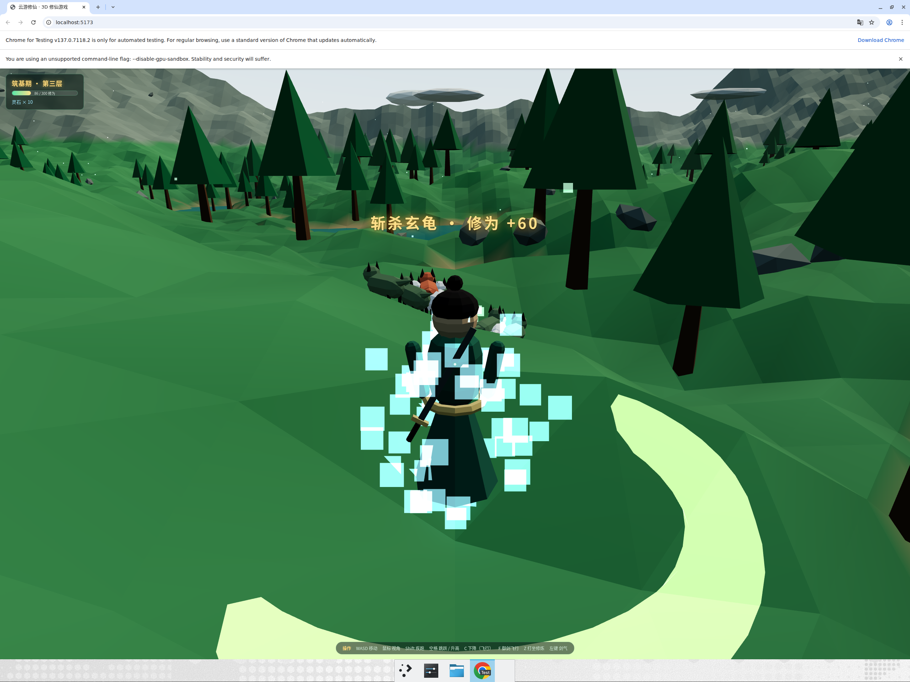

# 云游修仙 · 3D 修仙游戏

基于 Three.js + Vite 的浏览器 3D 修仙游戏原型。



## 玩法

- 程序化生成的修仙世界：青山、云海、湖泊、浮空仙岛、灵树
- 第三人称角色操控
- **御剑飞行**：踩剑飞行，俯瞰云海仙岛
- **打坐修炼**：入定积累修为，灵气汇聚
- **境界突破**：练气 → 筑基 → 金丹 → 元婴 → 化神 → 合体 → 渡劫 → 大乘
- **斩妖除魔**：剑气攻击灵兽（灵狐 / 玄龟 / 赤焰狼），获得修为与灵石

## 操作

| 按键 | 功能 |
| --- | --- |
| 鼠标点击画面 | 锁定鼠标 |
| WASD | 移动 |
| 鼠标 | 视角 |
| Shift | 疾跑 |
| 空格 | 跳跃 / 飞行升高 |
| C / Ctrl | 飞行下降 |
| F | 御剑飞行开关 |
| Z | 打坐修炼开关 |
| 鼠标左键 | 发射剑气 |

## 开发

```bash
npm install
npm run dev      # http://localhost:5173
npm run build    # 产物在 dist/
```

## 代码结构

```
src/
  main.js        入口、渲染循环、输入与相机
  world.js       程序化世界：地形/湖泊/浮空岛/植被/云/灵气粒子
  player.js      修士模型与移动/飞行/打坐控制器
  cultivation.js 境界与修为系统
  beasts.js      灵兽生成与 AI（游荡/逃跑）
  effects.js     剑气弹道、粒子爆发、修炼光环、突破光环
  hud.js         中文 HUD（境界/修为/灵石/横幅）
```
